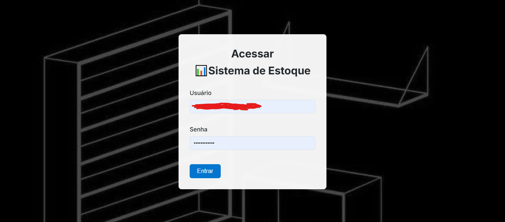
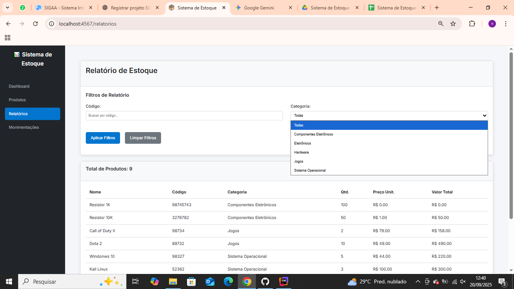
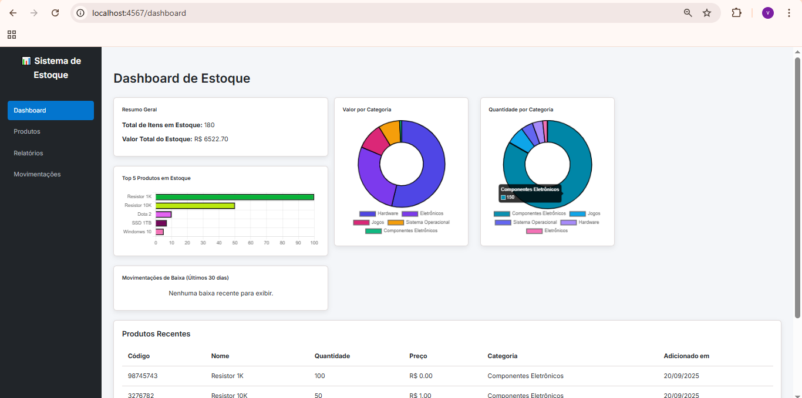

## 🛠️ RB-GerenciadorEstoque

[](https://www.ruby-lang.org/)
[](https://www.fxruby.org/)
[](https://www.sqlite.org/)
[](LICENSE)

---

## 📌 Descrição

O **RB-GerenciadorEstoque** é um sistema desktop desenvolvido em Ruby com FXRuby, destinado à gestão eficiente de produtos em estoque.  
A aplicação permite realizar operações como cadastro, edição, exclusão e exportação de produtos para **CSV** ou **Google Sheets**, além de gerar gráficos interativos que exibem a quantidade e o valor dos produtos por categoria.

---

## ✅ Funcionalidades

- **Cadastro de novos produtos**
- **Edição de informações existentes**
- **Exclusão de múltiplos produtos**
- **Integração com Google Sheets** para consulta e atualização de dados online
- **Gráficos interativos** por categoria, quantidade e valor

---

## 🧰 Tecnologias Utilizadas

- **Ruby** – Linguagem principal
- **SQLite** – Banco de dados local
- **Google Sheets API** – Sincronização e exportação online

---

## 📁 Estrutura do Projeto

```

RB-GerenciadorEstoque/
├── app.rb                # Arquivo principal
├── cria\_usuario.rb       # Criação de usuários
├── gera\_hash.rb          # Geração de hashes
├── migracao\_relatorios.rb # Migração de dados
├── estoque.db            # Banco de dados SQLite
├── Gemfile               # Dependências
├── README.md             # Documentação
├── public/               # Arquivos públicos
├── vendor/cache/         # Cache de dependências
└── views/                # Arquivos de visualização

````

---

## 📥 Como Rodar

1. Clone o repositório:

```bash
git clone https://github.com/VICTORGG04/RB-GerenciadorEstoque.git
cd RB-GerenciadorEstoque
````

2. Instale as dependências:

```bash
bundle install
```

3. Execute a aplicação:

```bash
ruby app.rb
```

4. **Exportação para Google Sheets**

* Configure a API do Google Sheets com credenciais JSON.
* Insira o arquivo de credenciais na pasta `config/` (ou local definido no código).
* Utilize o script de exportação para enviar dados do estoque para sua planilha online.

---

## 📸 Capturas de Tela

### Tela de Login


### Dashboard Relatório


### Dashboard com Dados


---

## 📈 Gráficos Interativos

A aplicação gera gráficos que permitem visualizar rapidamente a **quantidade** e o **valor** dos produtos por categoria, facilitando o controle do estoque.

---

## 💡 Contribuições

Contribuições são bem-vindas!
Abra uma **issue** ou envie um **pull request** para sugerir melhorias.

---

## 📝 Licença

Este projeto está sob a licença [MIT](LICENSE).

---

## 🔗 Links Úteis

* [Ruby](https://www.ruby-lang.org/)
* [SQLite](https://www.sqlite.org/)
* [Google Sheets API](https://developers.google.com/sheets/api)

---

